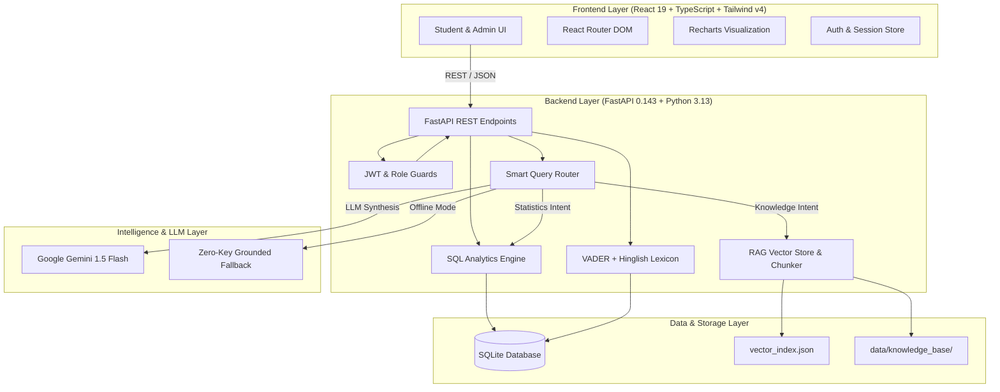

# Student Feedback Assistant: Intelligent Academic Intelligence & CIE Evaluation Platform

[](https://fastapi.tiangolo.com)
[](https://react.dev)
[](https://www.typescriptlang.org)
[](https://www.python.org)
[](https://tailwindcss.com)
[](LICENSE)

An institutional-grade, full-stack educational intelligence web application developed for college **Continuous Internal Evaluation (CIE)** projects (20 marks). It demonstrates full-stack software engineering, relational database operations, domain-specific NLP sentiment analysis, Retrieval-Augmented Generation (RAG), and data visualization.

---

## 🌟 Key Features

1. **Multi-Dimensional Rubric Evaluations**:
   - Students grade courses across 4 criteria: *Overall Satisfaction*, *Teaching Clarity*, *Course Content*, and *Practical & Laboratory Sessions*.
   - Cryptographic SHA-256 duplicate checking to prevent accidental double submissions.
   - Anonymity toggle (`user_id = null`) to ensure student psychological safety and privacy.

2. **Real-Time NLP Sentiment Analysis**:
   - Enhanced **VADER (Valence Aware Dictionary and sEntiment Reasoner)** engine running with sub-5ms latency and zero external API dependencies.
   - Domain-specific **Hinglish Lexicon** (e.g. *bohot achha, bekar, samajh aa gaya, doubt clear nahi hota*).
   - Real-time extraction of 6 academic thematic tags (`teaching_clarity`, `practical_sessions`, `course_content`, `pace_and_workload`, `classroom_environment`, `exams_and_evaluation`).
   - Admin re-run endpoint (`/api/feedback/rerun-sentiment`) for dynamic recalculation.

3. **RAG (Retrieval-Augmented Generation) Knowledge Base**:
   - Pure-Python **TF-IDF & Cosine Similarity vector store** (zero heavy binary wheels or PyTorch compilation locks).
   - Ingests Markdown (`.md`), Plain Text (`.txt`), Adobe PDF (`.pdf`), and JSON (`.json`) files under 10MB into ~500 character chunks with 50-character overlap.
   - Directory of **100 curated Frequently Asked Questions (FAQs)** with category filtering and instant lookups.
   - Source citations with relevance scores displayed alongside answers.

4. **Conversational AI Assistant**:
   - Smart query router:
     - **Statistical Intent** ➡️ Direct SQLite calculations via `AnalyticsService` (never LLM hallucination).
     - **Knowledge Intent** ➡️ Semantic search over RAG vector store and 100 FAQs.
     - **General Intent** ➡️ Pedagogical guidance with safety guardrails.
   - Dual-mode LLM abstraction: Google Gemini API (free tier) with automated **Zero-Key Offline Fallback** that displays verified citations.
   - Multi-turn conversation sessions, suggested prompts, message helpfulness rating (Thumbs-Up/Down), and clipboard copy.

5. **Administrative Analytics & Telemetry**:
   - Visual KPI metrics: Total Submissions, Satisfaction Index, Clarity, Content, and Practicals.
   - Interactive charts via **Recharts**: Sentiment Donut Chart, 5-Star Rating Histogram, Subject Benchmark Bar Chart, and Longitudinal Daily Trajectory Line Chart.
   - Grounded executive AI summary derived directly from computed SQL arithmetic.
   - Instant streaming **CSV export** for SPSS, Excel, and departmental reporting.
   - Live system health diagnostics (`/api/health`) and viva defense telemetry.

---

## 🏛️ System Architecture



---

## 📂 Project Structure

```text
student-assistant/
├── backend/
│   ├── app/
│   │   ├── api/             # FastAPI routers (auth, feedback, analytics, knowledge, chat, deps)
│   │   ├── core/            # Configuration (Settings) and security (JWT, bcrypt)
│   │   ├── database/        # SQLite engine & SessionLocal factory
│   │   ├── models/          # SQLAlchemy ORM models (User, Subject, Feedback, Knowledge, FAQ)
│   │   ├── schemas/         # Pydantic v2 validation models
│   │   ├── services/        # Business logic (analytics, sentiment, rag, chat_router)
│   │   └── main.py          # Application entrypoint, CORS, startup hooks, /api/health
│   ├── data/
│   │   ├── knowledge_base/  # Authoritative starter markdown documents
│   │   ├── vector_store/    # Local vector index (vector_index.json)
│   │   └── student_assistant.db  # SQLite database
│   ├── scripts/
│   │   └── init_and_seed.py # Automated DB init, 50 demo feedback entries, 100 FAQs, RAG indexer
│   └── tests/
│       └── test_backend.py  # 9 comprehensive Pytest unit & integration tests
├── frontend/
│   ├── src/
│   │   ├── components/      # Institutional Navbar, modals, badges
│   │   ├── context/         # AuthContext (JWT, user state, viva demo switcher)
│   │   ├── pages/           # 8 full pages (Landing, Login, Dashboard, Submit, History, Chat, Search, Admin, Knowledge, Status)
│   │   ├── services/        # Typed Axios API client
│   │   ├── types/           # Complete TypeScript interfaces
│   │   ├── App.tsx          # Client-side router configuration
│   │   ├── main.tsx         # React root mounting
│   │   └── index.css        # Academic Clarity Tailwind v4 tokens
│   ├── package.json
│   └── vite.config.ts
├── docs/
│   ├── VIVA_PREPARATION.md  # 25+ viva questions, architectural justification, examiners guide
│   └── DEMO_SCRIPT.md       # 5-minute step-by-step viva presentation flow
├── .env.example             # Template for optional keys
└── README.md
```

---

## ⚡ Quick Start Guide (Windows)

### Prerequisites
- **Python 3.10+** (Python 3.13 supported)
- **Node.js v18+** (v22 verified) and **npm**

### 1. Backend Setup & Database Seeding

Open PowerShell in the workspace root:

```powershell
# Activate the existing virtual environment (or create one: python -m venv test_env)
.\test_env\Scripts\activate

# Install dependencies (already pre-installed in test_env)
pip install -r backend/requirements.txt  # (or fastAPI, uvicorn, sqlalchemy, vaderSentiment, etc.)

# Initialize tables, seed 6 subjects, 50 demo feedback records, 100 FAQs, and ingest RAG index
python backend/scripts/init_and_seed.py
```

### 2. Run Backend API Server

```powershell
# Start FastAPI backend on port 8000
python -m uvicorn app.main:app --app-dir backend --host 127.0.0.1 --port 8000 --reload
```
- Interactive Swagger API Documentation: `http://localhost:8000/docs`
- Health Telemetry Endpoint: `http://localhost:8000/api/health`

### 3. Run Frontend Application

In a second PowerShell terminal:

```powershell
cd frontend
npm install
npm run dev
```
- Frontend Application URL: `http://localhost:5173`

---

## 🔑 Default Demonstration Credentials

| Role | Email | Password | Access Level |
|---|---|---|---|
| **Administrator** | `admin@institution.edu` | `Admin@123` | Full Admin Analytics, CSV Export, RAG Document Upload, FAQ Management |
| **Student** | `student@institution.edu` | `Student@123` | Student Dashboard, Course Evaluation Form, Feedback History, AI Assistant |

> 💡 **Viva Tip**: On the top navbar, click the **Student** or **Admin** toggle pills to switch demo sessions instantly with one click without manually typing credentials!

---

## 🧪 Running Automated Tests

Run the Pytest suite to verify mathematical calculations, role authorization, and RAG retrieval:

```powershell
.\test_env\Scripts\pytest .\backend\tests\test_backend.py -v
```

Expected output: **9 passed in ~5 seconds** covering:
- Health check & database connection
- Admin & student JWT authentication
- Role-based 401/403 security guards
- Real-time VADER & Hinglish sentiment engine
- Feedback submission & cryptographic duplicate detection
- Analytics exact arithmetic calculation verification
- Streaming CSV export
- RAG semantic vector search
- Smart Chatbot query routing (SQL analytics vs RAG knowledge)

---


---

## 📄 License & Academic Integrity

This project is authored as a College Continuous Internal Evaluation (CIE) capstone demonstration. All demonstration data is explicitly labeled with `is_demo=true`.
